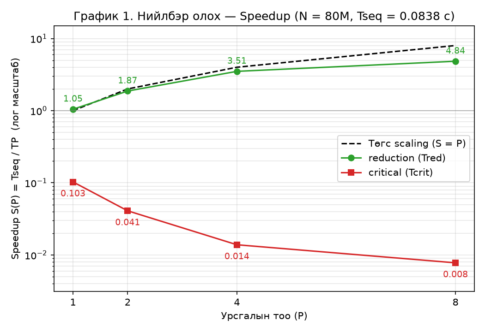
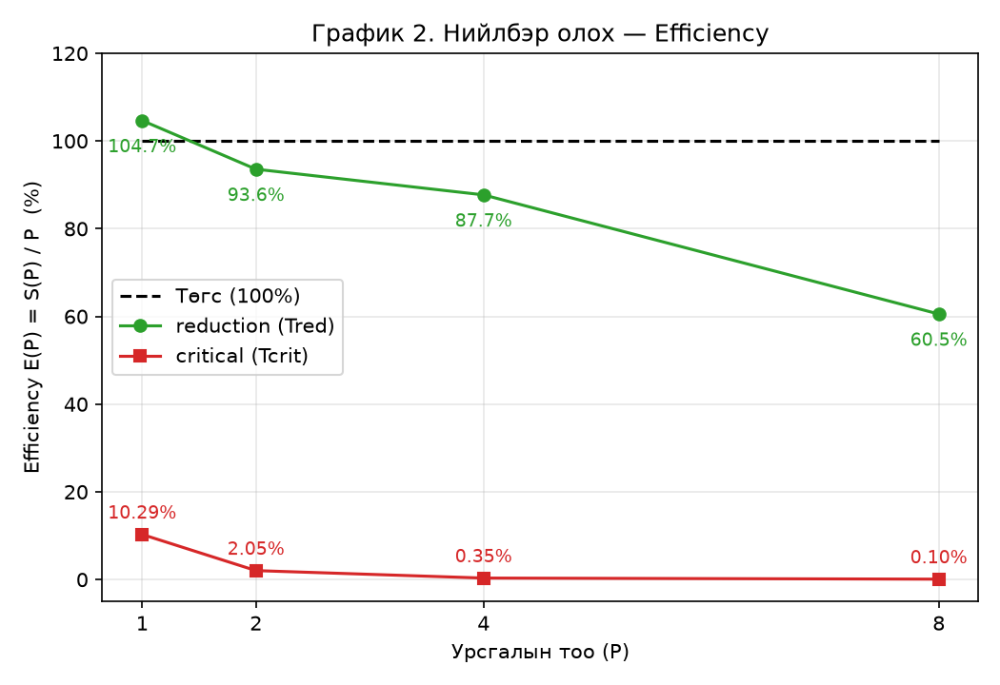

# Лабораторийн ажил №3 — Тайлан

**Хичээл:** Өндөр гүйцэтгэлтэй тооцоолол  
**Сэдэв:** OpenMP — дундын өгөгдөл, race condition, critical ба reduction, first touch  
**Оюутан:** ____________________ &nbsp;&nbsp; **Огноо:** 2026-10-05

## 1. Ашигласан машин ба орчин

| Үзүүлэлт | Утга |
|---|---|
| CPU | 11th Gen Intel Core i5-11300H @ 3.10 GHz (turbo 4.4 GHz) |
| Цөм / урсгал | 4 физик цөм, 8 логик (Hyper-Threading), 1 сокет |
| Кэш | L1d 48 KB/цөм, L2 1.25 MB/цөм, L3 8 MB (нийтийн) |
| RAM | 14 GiB |
| NUMA | 1 зангилаа (`numactl --hardware`: `available: 1 nodes (0)`) |
| OS | Linux 7.0.0-38-generic (Ubuntu) |
| Компайлер | gcc (Ubuntu 15.2.0-16ubuntu1) 15.2.0 |
| Компайлын флаг | `gcc -fopenmp -O3 -o lab3 lab3.c timer.c` |
| **N** | **80 000 000** (3 массив × 8 байт ≈ 1.92 GB) |
| Давталт | Хувилбар бүрийг 3 удаа хэмжиж дундажласан |

## 2. Хэрэгжүүлэлт

| Файл | Агуулга |
|---|---|
| `lab3.c` | A1–A3, B1–B4 бүх хувилбар; malloc-ийн NULL шалгалт; c[i] ба нийлбэрийн зөв эсэхийн шалгалт |
| `timer.c`, `timer.h` | Сурах бичгийн 17.2 хэсгийн `cpu_timer_start` / `cpu_timer_stop` (`CLOCK_MONOTONIC`) |
| `Makefile` | `lab3` (-O3) ба `lab3_O0` (-O0, асуулт 6) |
| `run_benchmarks.sh` | `OMP_NUM_THREADS` = 1, 2, 4, 8 дээр бүгдийг ажиллуулж `results/results.csv`-д хадгална |
| `analyze.py` | Хүснэгт 1–5, График 1–2 үүсгэнэ |

Хэмжилтийн журам:

* Хугацаанд зөвхөн тооцооллын давталт орно. `malloc` ба инициализаци ордоггүй. A3-ын параллель инициализацийг тусад нь хэмжсэн.
* A1, A2 нь **цуваа** инициализацитай массив дээр, A3 ба B1–B4 нь **шинээр хуваарилж параллель (first touch)** инициализацилсан массив дээр ажиллана. Ингэснээр A2 ба A3-ын санах ойн хуудсыг өөр өөр урсгал анх хүрсэн байна.
* `c` массивыг мөн инициализацид оруулсан. Ингэхгүй бол эхний хэмжилтэд `c`-ийн page fault-ууд нэмэгдэж хугацааг гажуудуулна.
* Хувилбар бүрийн дараа `c[i] == 3.0` эсэх, нийлбэр `240 000 000` эсэхийг шалгасан. A1–A3, B1, B3, B4-ийн бүх ажиллуулалт зөв гарсан.

## 3. Үр дүнгийн хүснэгтүүд

### Хүснэгт 1. Суурь хэмжилт — дараалсан хувилбарууд (Tseq)

`OMP_NUM_THREADS=1` программын 3 ажиллуулалтын дундаж. Доорх бүх Speedup-д хуваарь болно.

| Дараалсан хувилбар | Хугацаа (сек) |
|---|---|
| A1 — Вектор нэмэх: c[i] = a[i] + b[i] | 0.1048 |
| B1 — Нийлбэр олох: sum += c[i] | 0.0838 |

### Хүснэгт 2. Вектор нэмэх: параллель хувилбарууд

| Урсгалын тоо | Tprag (сек) | Tft (сек) | Параллель инициализаци, A3 (сек) |
|---|---|---|---|
| 1 | 0.0983 | 0.0976 | 0.5385 |
| 2 | 0.0851 | 0.1008 | 0.3108 |
| 4 | 0.0851 | 0.0839 | 0.1964 |
| 8 | 0.0887 | 0.0912 | 0.1666 |

Tprag ба Tft хоёрын ялгаа системтэй биш, хэмжилтийн шуугианы хэмжээнд байна (асуулт 5-ыг үз).

### Хүснэгт 3. Нийлбэр олох: параллель хувилбарууд

| Урсгалын тоо | Trace (сек) | Tcrit (сек) | Tred (сек) |
|---|---|---|---|
| 1 | 0.0852 | 0.8136 | 0.0800 |
| 2 | 0.0425 | 2.0448 | 0.0448 |
| 4 | 0.0259 | 6.0459 | 0.0239 |
| 8 | 0.0175 | 10.7616 | 0.0173 |

**1 урсгалын мөр (OpenMP-ийн нэмэлт зардал):** Tred(1) = 0.0800 с ба Trace(1) = 0.0852 с нь Tseq = 0.0838 с-тэй бараг тэнцүү. Энгийн `parallel for`-ийн overhead (урсгал үүсгэх, давталт хуваах) 80 сая элементтэй ажилд хэмжигдэхээргүй бага байна. Харин **Tcrit(1) = 0.8136 с нь Tseq-ээс 9.7 дахин удаан**. Ганц урсгалтай, өрсөлдөгчгүй үед ч `critical` нь давталт бүрт түгжээ авч суллах (`GOMP_critical_start/end`) дуудлага хийдэг. Энэ нь нэг нэмэлтэд ойролцоогоор 9 нс нэмдэг.

### Хүснэгт 4. Race condition-ийн үр дүн (B2, -O3, 3 удаа ажиллуулсан)

| Урсгалын тоо | Ажиллуулалт 1 | Ажиллуулалт 2 | Ажиллуулалт 3 | Зөв хариу |
|---|---|---|---|---|
| 2 | 120 000 000 | 120 000 000 | 120 000 000 | 240 000 000 |
| 4 | 60 000 000 | 60 000 000 | 60 000 000 | 240 000 000 |
| 8 | 30 000 000 | 30 000 000 | 30 000 000 | 240 000 000 |

### Хүснэгт 4б. Race condition-ийн үр дүн (B2, -O0, асуулт 6)

| Урсгалын тоо | Ажиллуулалт 1 | Ажиллуулалт 2 | Ажиллуулалт 3 | Зөв хариу |
|---|---|---|---|---|
| 2 | 125 622 705 | 123 343 278 | 121 878 105 | 240 000 000 |
| 4 | 74 063 343 | 72 513 144 | 73 038 177 | 240 000 000 |
| 8 | 41 203 803 | 37 564 284 | 40 423 410 | 240 000 000 |

### Хүснэгт 5. Speedup ба Efficiency (Tseq = B1 = 0.0838 с)

| Урсгалын тоо | S(crit) | E(crit) | S(red) | E(red) |
|---|---|---|---|---|
| 1 | 0.1029 | 10.29% | 1.05 | 104.7% |
| 2 | 0.0410 | 2.05% | 1.87 | 93.6% |
| 4 | 0.0139 | 0.35% | 3.51 | 87.7% |
| 8 | 0.0078 | 0.10% | 4.84 | 60.5% |

Томьёо: S(P) = Tseq / T_P, E(P) = S(P) / P. P = 1 үеийн 104.7% нь Tred(1) Tseq-ээс 4.5%-иар хурдан гарсантай холбоотой. Энэ нь давтамж (turbo) ба хэмжилтийн шуугианы хэмжээнд байна.

## 4. Графикууд



Speedup-ийн Y тэнхлэг логарифм масштабтай: S(crit) 0.1-ээс 0.008 хүртэл, S(red) 1-ээс 4.8 хүртэл байгаа тул шугаман масштабаар critical-ийн муруй тэг дээр наалдана.



## 5. Дүн шинжилгээний асуултууд

### 1. Урсгалын тоо нэмэгдэхэд Tcrit яагаад сайжрахгүй, бүр муудаг вэ?

Хэмжилтээр Tcrit = 0.81 → 2.04 → 6.05 → 10.76 с (P = 1, 2, 4, 8) болж, урсгал нэмэх бүрт **удааширсан**. Нэг нэмэлтэд ногдох хугацаа нь:

| P | Tcrit / N |
|---|---|
| B1 (цуваа) | 1.05 нс |
| 1 | 10.2 нс |
| 2 | 25.6 нс |
| 4 | 75.6 нс |
| 8 | 134.5 нс |

Механизм:

1. `#pragma omp critical` нь `sum += c[i]` мөрийг нэг удаад **зөвхөн нэг урсгал** гүйцэтгэхийг баталгаажуулна. Тиймээс 80 сая нэмэлт бүгд дахин цуваа болдог. Параллель хэсэг гэж үлдэх юм бараг байхгүй: `c[i]`-г унших л параллель болно.
2. Давталт бүрт түгжээ авах ба суллах (атомик `lock cmpxchg` маягийн заавар) хийгддэг. Энэ нь өрсөлдөгчгүй үед ч 1 нс-ийн нэмэлтийг ~10 нс болгодог (P = 1).
3. Олон урсгалтай үед түгжээний хувьсагч ба `sum` хоёр **кэшийн мөр** нь цөм хооронд байнга шилждэг (cache-line ping-pong, MESI протоколоор invalidate). Түгжээ хүлээж буй урсгалууд spin хийж эсвэл futex-ээр унтаж сэрдэг. Урсгал олон байх тусам нэг түгжээний төлөөх өрсөлдөөн нэмэгдэж, нэмэлт бүр 25 → 75 → 135 нс болж өссөн.
4. P = 8 үед Hyper-Threading-ийн хос урсгал нэг физик цөмийг хуваалцаж, spin хийж буй урсгал түгжээ эзэмшиж буй урсгалын нөөцийг идэж байна.

Ингээд гүйцэтгэх ажил нь цуваа хэвээр, харин синхрончлолын зардал P-тэй хамт өсдөг тул Tcrit муудна.

### 2. Tred яагаад Tcrit-ээс эрс хурдан вэ? Кодын түвшинд ялгаа

P = 8 үед Tcrit / Tred = 10.76 / 0.0173 ≈ **622 дахин**, P = 4 үед ≈ **253 дахин** ялгаатай.

**critical:** `sum` нь бүх урсгалд **нэг дундын хувьсагч**. Нэмэлт бүрийн өмнө, дараа түгжээ ажилладаг тул **N = 80 000 000 удаа синхрончлол** хийгдэнэ:

```c
for (i = my_start; i < my_end; i++) {
    GOMP_critical_start();   // түгжээ авах — бусад урсгал хүлээнэ
    sum += c[i];             // дундын санах ой руу унших/бичих
    GOMP_critical_end();     // түгжээ суллах
}
```

**reduction(+:sum):** OpenMP урсгал бүрт **хувийн** `sum_local = 0` хувьсагч үүсгэдэг. Давталтын турш урсгал зөвхөн өөрийн хувийн хувьсагч (регистр) руу нэмдэг тул дундын санах ойд хандахгүй, түгжээгүй. Давталт дуусахад хувийн нийлбэрүүдийг дундын `sum` руу нэг удаа атомикаар нэмнэ. Ингээд **зөвхөн P удаа (8 удаа)** синхрончлол хийгдэнэ:

```c
double sum_local = 0.0;                     // урсгал бүрийн хувийн
for (i = my_start; i < my_end; i++)
    sum_local += c[i];                      // түгжээгүй, регистрт
atomic_add(&sum, sum_local);                // нэг удаа
```

Синхрончлолын тоо 80 000 000-аас 8 болж буурч байгаа нь Tred ≈ Tseq / P байх, Tcrit ≈ Tseq × 10…130 байх шалтгаан юм. Мөн reduction нь хариуг **зөв** (240 000 000) гаргадаг. Энэ нь B2-оос ялгарах гол зүйл: хурд нь B2-той ижил (0.0173 vs 0.0175 с) боловч race condition-гүй.

### 3. Хүснэгт 4-ийн гурван үр дүн ялгаатай юу? Юуг харуулж байна вэ?

**-O3 дээр гурван ажиллуулалт хоорондоо ялгаагүй**, гэхдээ бүгд **буруу**: яг 240 000 000 / P (120 сая, 60 сая, 30 сая). Энэ нь race condition байхгүй гэсэн үг биш, харин түүний **нэг тодорхой хэлбэр** юм. `objdump`-аар B2-ын хөрвүүлсэн кодыг шалгахад:

```text
movsd  (%rbx),%xmm0        ; дундын sum-ийг НЭГ удаа регистрт ачаална (0.0)
.loop:
addsd  (%rdx),%xmm0        ; бүх нэмэлт регистрт — санах ой руу бичихгүй
addsd  -0x8(%rdx),%xmm0
...
movsd  %xmm0,(%rbx)        ; эцэст нь НЭГ удаа дундын sum руу бичнэ
```

`sum` хамгаалагдаагүй тул хөрвүүлэгч өөр урсгал түүнийг өөрчлөхгүй гэж үзэж (C хэлний санах ойн загварт data race нь undefined behavior), давталтын турш регистрт хадгалдаг. Урсгал бүр 0-ээс эхлэн зөвхөн өөрийн хэсгийн (N/P × 3.0) нийлбэрийг тооцож, эцэст нь дундын `sum`-ийг **дарж бичдэг**. Сүүлд бичсэн урсгалын утга л үлдэх тул хариу яг 240 000 000 / P болно. Бүх урсгалын хэсэг ижил хэмжээтэй, c[i] бүгд 3.0 тул аль урсгал сүүлд бичсэнээс үл хамааран утга ижил гардаг. Иймээс -O3 дээр "тогтвортой буруу" хариу гарсан.

Үүний дүгнэлт:

* Race condition-ийн үр дүн нь **хөрвүүлэгч, оновчлол, хуваарилалтаас хамаарах тодорхойгүй зан төлөв**. Тогтвортой утга гарч байгаа нь код зөв гэсэн үг биш.
* Өгөгдлийн утга өөр байсан бол (c[i] ялгаатай) аль урсгал сүүлд бичихээс хамаарч ажиллуулалт бүрт өөр хариу гарна. -O0 дээр яг ингэж ялгаатай гарсныг Хүснэгт 4б харуулж байна (асуулт 6).

### 4. Efficiency хэрхэн өөрчлөгдөж байна? Amdahl-ийн хуультай холбох

E(red) = 104.7% → 93.6% → 87.7% → 60.5%, E(crit) = 10.3% → 2.05% → 0.35% → 0.10%. Урсгал нэмэгдэх тусам хоёулангийнх нь efficiency буурч байна.

Amdahl-ийн хууль: цуваа хэсгийн хувь f бол **S(P) = 1 / (f + (1 − f)/P)**, S(∞) ≤ 1/f. Хэмжсэн S-ээс f-ийг буцааж тооцвол (Karp–Flatt метрик) **f = (1/S − 1/P) / (1 − 1/P)**:

| P | S(red) | f (тооцоолсон) | Amdahl-ийн таамаг (f = 0.047) |
|---|---|---|---|
| 2 | 1.87 | 0.070 | 1.91 |
| 4 | 3.51 | 0.047 | 3.51 |
| 8 | 4.84 | 0.093 | 6.02 |

* **reduction:** Цуваа хэсэг нь урсгал үүсгэх/нэгтгэх (fork/join) ба P хувийн нийлбэрийг нэгтгэх алхам. Энэ нь микросекундын хэмжээнд байх тул f маш бага, P = 4 хүртэл scaling сайн (87.7%). Гэхдээ P = 8 үед хэмжсэн S = 4.84 нь f = 0.047-оор Amdahl-ийн таамагласан 6.02-оос доогуур байна. Ялгааг программын цуваа хэсэг биш, **техник хангамжийн хуваалцсан нөөц** үүсгэж байна:
  1. Машин **4 физик цөмтэй**. 5–8 дахь урсгал нь Hyper-Threading бөгөөд нэг цөмийн гүйцэтгэх нэгжийг хуваалцдаг тул бүтэн цөм нэмэхтэй адилгүй.
  2. **Санах ойн зурвас:** Tred(8) үед 80M × 8 байт / 0.0173 с ≈ **37 GB/s** уншиж байна. Энэ нь зөөврийн компьютерийн санах ойн бодит дээд зурваст ойрхон (вектор нэмэх 4 урсгалаар ч ≈ 23 GB/s-ээс хэтрээгүй) тул цаашид урсгал нэмэхэд хурд төдийлөн өсөхгүй. Санах ойн шугам бүх урсгалд нэг тул энэ нь Amdahl-ийн утгаар "цуваа хэсэг" шиг ажилладаг.
  3. Turbo давтамж олон цөм ачаалагдахад буурдаг (4.4 GHz нэг цөм дээр, бүх цөм дээр бага).
* **critical:** Бүх нэмэлт түгжээн дотор байгаа тул f ≈ 1. Amdahl-ийн хуулиар S ≤ 1/f ≈ 1 буюу хурдсах боломж огт байхгүй. Бодит S нь 1-ээс ч доогуур (0.10 → 0.008) байгаа нь Amdahl-ийн загварт ордоггүй **синхрончлолын зардал** P-тэй хамт өсдөгийг харуулж байна. Efficiency = S/P тул S буурч, P өсөх хоёр хүчин зүйл давхцаж E(crit) 0.1% хүртэл унасан.

Дүгнэлт: Efficiency буурах нь Amdahl-ийн хуулийн шууд үр дагавар. Цуваа хэсэг (эсвэл хуваалцсан нөөц) бага ч гэсэн P өсөх тусам тэр хэсгийн жин нэмэгддэг тул S(P) нь P-ээс улам хоцорч, E(P) = S/P буурна.

### 5. Tprag ба Tft хооронд ялгаа гарсан уу? NUMA зангилаа хэд вэ?

**Ялгаа гараагүй.** P = 4 үед 0.0851 vs 0.0839 с, P = 8 үед 0.0887 vs 0.0912 с байна. P = 2 үед Tft 0.1008 с гарч 18% удаан харагдсан тул P = 2 дээр дахин 3 удаа хэмжихэд A2 = 0.094 / 0.081 / 0.078 с, A3 = 0.089 / 0.083 / 0.083 с гарсан. Аль нь хурдан нь ээлжилж байгаа тул энэ нь first touch-ийн нөлөө биш, **хэмжилтийн шуугиан** (turbo давтамж, бусад процесс) юм.

`numactl --hardware`:

```text
available: 1 nodes (0)
node 0 cpus: 0 1 2 3 4 5 6 7
node distances:
node   0
  0:  10
```

Миний системд **1 NUMA зангилаа** байна: 1 сокет, бүх 8 логик CPU нэг санах ойн хянагчтай. First touch бодлогоор Linux хуудсыг түүнийг анх бичсэн урсгалын NUMA зангилааны санах ойд байрлуулдаг. Олон сокеттэй серверт цуваа инициализаци хийвэл бүх хуудас 0-р зангилаанд очиж, бусад сокетын урсгалууд алсын (remote) санах ойгоос удаан уншдаг. Энд бол ганц зангилаа тул аль урсгал инициализаци хийсэн нь хамаагүй: хуудас ямар ч байсан бүх цөмд ижил зайтай (distance = 10) нэг санах ойд байрлана. Тиймээс Tprag ≈ Tft байх нь хэвийн.

Нэмэлт ажиглалт:

* **Вектор нэмэх нь санах ойн зурвасаар хязгаарлагдсан.** Tseq = 0.1048 с үед 80M × 24 байт / 0.1048 ≈ 18 GB/s, 4 урсгалтай үед ≈ 23 GB/s байна. Ганц цөм аль хэдийн зурвасын ихэнхийг ашиглаж байгаа тул параллель болгосноор ердөө 1.2 дахин хурдассан (B хэсгийн reduction-тэй харьцуулахад бага).
* **First touch-ийн харагдах цорын ганц нөлөө нь инициализацийн хугацаа:** 0.54 с (1 урсгал) → 0.17 с (8 урсгал). Хуудсыг анх хүрэхэд kernel page fault боловсруулж хуудсыг тэглэдэг. Параллель инициализацид энэ ажлыг олон цөм хуваалцдаг тул хурдассан.

### 6. Нэмэлт: B2-ыг -O0 ба -O3-аар харьцуулах

| | -O3 (Хүснэгт 4) | -O0 (Хүснэгт 4б) |
|---|---|---|
| Үр дүн | Яг 240M / P, 3 ажиллуулалт ижил | 240M / P-ээс арай их, ажиллуулалт бүрт **өөр** |
| P = 8 | 30 000 000 (×3) | 41.2M, 37.6M, 40.4M |
| Хугацаа (P = 8) | 0.0175 с | ≈ 0.23 с |

Яагаад өөр вэ? Хөрвүүлсэн кодыг харьцуулбал:

* **-O3:** `sum`-ийг давталтын өмнө регистрт ачаалж, бүх нэмэлтийг регистрт хийгээд, эцэст нь нэг удаа бичдэг. Урсгалын хооронд "уралдаан" зөвхөн төгсгөлийн нэг бичилт дээр болж, сүүлд бичсэн урсгалын хувийн нийлбэр (= 240M / P) үлддэг. Үр дүн детерминист мэт харагдана.
* **-O0:** Давталт бүрт **санах ойгоос унших, нэмэх, санах ой руу бичих** гэсэн гурван тусдаа алхам хийдэг:

```text
movsd  (%rax),%xmm0      ; sum-ийг санах ойгоос унших
addsd  %xmm1,%xmm0       ; c[i]-г нэмэх
movsd  %xmm0,(%rax)      ; sum руу буцааж бичих
```

Хоёр урсгал ижил хуучин утгыг уншаад тус тусдаа бичвэл нэг нь нөгөөгийнхөө нэмэлтийг устгадаг (**lost update**). Алдагдах нэмэлтийн тоо урсгалуудын цаг хугацааны давхцал (кэшийн мөр хэзээ шилжих, OS хуваарилалт)-аас хамаардаг тул ажиллуулалт бүрт **санамсаргүй өөр** хариу гарна. Ихэнх нэмэлт алдагдаж, урсгалууд бие биеийн шинэчлэлтийг цөөн удаа "амжиж" авдаг тул хариу 240M / P-ээс бага зэрэг их байна.

Энэ туршилт race condition-ийн үр дүн **кодоос биш, хөрвүүлэгч ба ажиллах үеийн цаг хугацааны тохиолдлоос** хамаардгийг харуулж байна. Нэг флагаар "тогтвортой" харагдаж байсан алдаа нөгөө флагаар санамсаргүй болж байна. Зөв шийдэл нь зөвхөн `reduction`, `atomic` эсвэл `critical` юм.

## 6. Дүгнэлт

* **Race condition (B2):** хурдан (Tred-тэй ижил) боловч хариу буруу. -O3 дээр 240M/P, -O0 дээр санамсаргүй гарсан.
* **critical (B3):** хариу зөв боловч бүх нэмэлтийг цуваа болгож, давталт бүрт түгжээ авдаг тул 1 урсгалтай үед ч Tseq-ээс 9.7 дахин, 8 урсгалтай үед **128 дахин удаан** (S = 0.0078).
* **reduction (B4):** хариу зөв, синхрончлол зөвхөн P удаа хийгддэг тул 8 урсгалтай үед **S = 4.84**, critical-аас **622 дахин хурдан**. 4 физик цөм хүртэл E ≈ 88%. Түүнээс цааш Hyper-Threading ба санах ойн зурвас (~37 GB/s) хязгаарладаг.
* **First touch:** 1 NUMA зангилаатай энэ зөөврийн компьютерт Tprag ≈ Tft (ялгаа шуугианы хэмжээнд). Нөлөө зөвхөн олон сокеттэй NUMA системд гарна.
